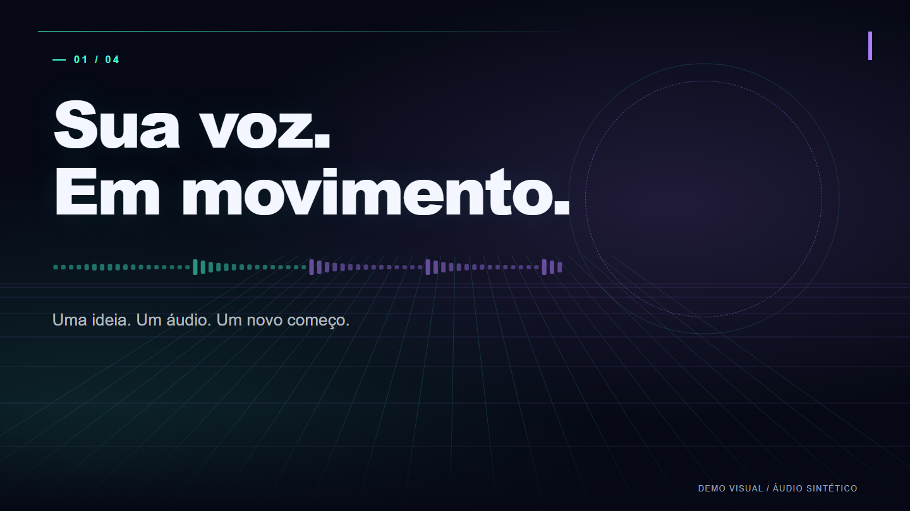

# Codex Motion Studio

**Seu áudio + seu pedido. O Codex cria o vídeo com Remotion.**

Um projeto do **Elton Machado** para criar introduções, textos animados e motion graphics
conversando com o Codex. Preparado para usar **Astra como modelo no Codex**.

Não há painel, site ou editor externo. Você pede no chat; o Codex instala as ferramentas,
prepara o áudio, monta as cenas, confere os frames e entrega o MP4.



## 1. Cole isto no Codex

```text
Instale este repositório para mim:
https://github.com/eltomachado/codex-motion-studio

Clone em uma pasta de projeto, leia o AGENTS.md e execute a instalação.
Quero usar tudo por este chat, sem abrir interface, site ou servidor.
Quando estiver pronto, vou mandar meu áudio e meu prompt.
```

O Codex precisa ter acesso a um ambiente que execute comandos e arquivos. No aplicativo
do computador, os arquivos são processados ali. Em uma sessão na nuvem, são processados
no ambiente dessa sessão. O projeto não é um serviço hospedado.

## 2. Envie seu áudio e o pedido

Escolha **Astra** no seletor de modelos do Codex, se estiver disponível na sua conta.
Anexe o áudio ou informe o caminho de um arquivo acessível. Depois, escreva por exemplo:

```text
Use o áudio que anexei para criar uma introdução para o meu canal.
Quero motion graphics no estilo cyberpunk, com fundo escuro, azul e roxo.
Os efeitos precisam ilustrar o que eu estou falando. Destaque poucas palavras,
grandes e no momento certo. Preserve a minha voz e o áudio inteiro.
Crie as cenas, confira a prévia e me entregue o vídeo pronto em MP4,
horizontal, 1920 x 1080, 30 fps. Faça tudo por aqui no Codex.
```

Para revisar: **“Aumente o texto da segunda cena e deixe a transição mais suave.”**
O Codex altera o projeto e pode exportar uma nova versão, preservando renders anteriores.

## O que já vem pronto

- Instalador das dependências de Remotion, FFmpeg e Chromium de renderização.
- Transcrição local com Whisper, incluindo tempos estimados das palavras.
- Importação de SRT e JSON no formato `Caption` do Remotion.
- Preservação do original e uma cópia WAV para reprodução compatível.
- Base cyberpunk com tipografia, comparação e forma de onda ligada ao áudio.
- Cenas editáveis pelo Codex, validação de tempos e exportação MP4 com áudio.
- Imagens de cada cena para o Codex revisar sem abrir uma interface.
- Exemplo visual de 12 segundos, gerado com som sintético próprio.

O **Astra interpreta seu prompt e escreve/ajusta as cenas**. Os scripts não fazem
essa parte sozinhos. Não existe chamada escondida a uma API de geração de vídeo,
nem chave OpenAI adicional exigida pelo projeto. O acesso ao Codex/Astra continua
dependendo da sua conta, do plano e dos limites disponíveis.

## O que o Codex precisa no ambiente

- Node.js **22.13+ ou 24 LTS**, npm e Git para clonar.
- Windows x64, macOS ou Linux x64 com suporte às dependências nativas.
- Internet na instalação e no primeiro download do modelo Whisper.
- Espaço para as dependências, o modelo e os vídeos; o tempo depende da máquina.

**Windows x64 é a plataforma verificada nesta versão.** macOS e Linux têm fluxo previsto
nos scripts, mas não foram testados nesta entrega. Linux pode precisar das bibliotecas
exigidas pelo Chromium. Consulte [solução de problemas](docs/PROBLEMAS.md).

O áudio é processado no ambiente de execução; a transcrição baixa os pesos do modelo,
sem enviar a gravação a uma API. O áudio ou a transcrição fornecidos ao próprio chat
ficam sujeitos ao funcionamento e às configurações de privacidade do Codex.

## Comandos que o Codex usa nos bastidores

Você pode continuar pedindo tudo em linguagem natural. Esta parte documenta o projeto.

```bash
node scripts/setup.mjs
npm run check
npm run demo
npm run render -- --id demo --quality draft
```

Com seu áudio e um arquivo de texto contendo o pedido:

```bash
npm run ingest -- --audio "inputs/minha-voz.mp3" --id minha-intro --prompt-file "inputs/prompt.txt"
```

Depois da ingestão, **o Codex deve ler o prompt e a transcrição, criar as cenas e mudar
o status para `ready`** em `public/projects/minha-intro/project.json`.
O renderizador recusa entregar o rascunho técnico como resultado criativo final.

```bash
npm run validate -- --id minha-intro
npm run render -- --id minha-intro --quality draft
npm run render -- --id minha-intro
```

Saída: `renders/minha-intro/DATA-HORA/minha-intro.mp4`, com imagens e relatório.
Prévia usa metade da resolução; exportação final usa a resolução definida no projeto.

Para usar legendas existentes, acrescente `--captions "inputs/fala.srt"` na ingestão.
Para outro idioma, por exemplo inglês, acrescente `--language en`.
O limite de ingestão desta versão é **15 minutos por áudio**.

## Sobre o visual e a sincronização

O exemplo é um ponto de partida. O Codex pode mudar cores, ritmo, tipografia e componentes
para seguir seu prompt. O áudio é preservado sem gerar outra voz. A transcrição automática
pode errar nomes e tempos; confira a prévia. SRT por frase não vira uma transcrição
precisa por palavra automaticamente.

O projeto cria animações programáticas; não produz filmagens fotorrealistas por conta
própria. Para usar fotos, vídeos ou músicas, forneça arquivos que você possa usar e peça
ao Codex para incorporá-los. Nada aqui exige comprar ou usar Higgsfield.

## Licença e referências

O código original usa licença [MIT](LICENSE). **As dependências mantêm suas próprias
licenças.** Remotion tem critérios para licença gratuita e licença empresarial: veja os
[termos oficiais](https://github.com/remotion-dev/remotion/blob/main/LICENSE.md).
Não significa que qualquer organização possa usar Remotion gratuitamente.

A pesquisa considerou [remotion-dev/skills](https://github.com/remotion-dev/skills),
[remotion-dev/template-audiogram](https://github.com/remotion-dev/template-audiogram) e
[haidrrrry/claude-remotion-skill](https://github.com/haidrrrry/claude-remotion-skill).
A implementação e o fluxo são próprios; veja [referências e licenças](docs/REFERENCIAS.md).

Projeto independente: não é um produto oficial da OpenAI, Remotion ou Higgsfield.
Abra issues com o erro e seu sistema operacional, sem áudio privado, chaves ou dados de conta.
